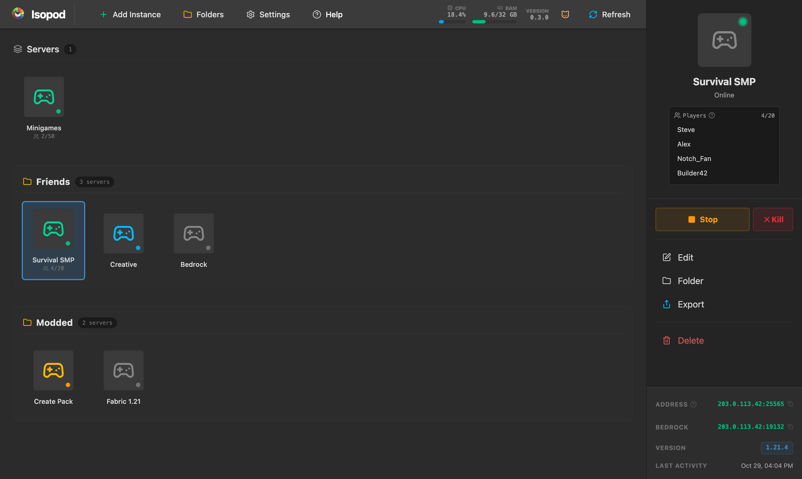

<p align="center">
  
</p>

<h1 align="center">Isopod</h1>

<p align="center">
  <strong>Self-hosted Minecraft servers, managed like Prism instances.</strong><br>
  A Docker-powered dashboard for Java and Bedrock servers, mods, modpacks, and backups.
</p>

<p align="center">
  <a href="https://github.com/Isopod-Project/Isopod/releases/latest"></a>
  <a href="LICENSE"></a>
  <a href="https://github.com/Isopod-Project/Isopod/actions/workflows/security-audit.yml"></a>
  <a href="https://github.com/Isopod-Project/Isopod/labels/good%20first%20issue"></a>
</p>

<p align="center">
  <a href="https://isopod-project.github.io/Isopod-Website/">Website</a> ·
  <a href="https://isopod-project.github.io/Isopod-Website/#/wiki">Wiki</a> ·
  <a href="#-quick-start">Quick Start</a> ·
  <a href="CONTRIBUTING.md">Contributing</a>
</p>



## ✨ Features
- **Prism-Like Instance Management**: Easily create, configure, and manage separate Minecraft server instances.
- **Smart Mod Management**: 
  - Integrated Search for **Modrinth**.
  - **Auto-Dependency Resolution**: Automatically find and add required library mods.
  - **Version/Loader Safety**: Warnings for mismatched mods (e.g., Forge mod on a Fabric server).
- **Modpacks**: Create an instance from a **Modrinth** or **CurseForge** modpack (CurseForge needs a free API key, see below).
- **Server Types**: Vanilla, Fabric, Forge, NeoForge, and Quilt for mods; Paper, Purpur, and Folia for plugins, each with a pickable loader version or build.
- **Bedrock Edition**: Run a native Bedrock Dedicated Server, or switch on **Bedrock cross-play** for a Paper, Purpur, Fabric, or NeoForge server to install Geyser and Floodgate so phone, console, and Windows players can join Java worlds.
  - **Server-Only Filtering**: Results are filtered to hide client-only mods by default.
- **Live Console & RCON**: 
  - Auto-scrolling logs with real-time updates.
  - Integrated RCON command input to execute commands on the fly.
- **Status Awareness**: Distinguishes between `Offline`, `Starting`, and `Online` states using log-based heartbeat detection.
- **Update World**: Offers a one-click Minecraft version upgrade when a newer release is available for an instance.
- **Self-Updating Dashboard**: Built-in updater with a progress overlay, automatic health-check reload, and in-dashboard release notes.
- **Desktop-Grade File Explorer**: Built-in file manager with right-click context menu (delete, rename, download, cut, copy, paste), drag-and-drop file moves & direct OS uploads, breadcrumb drop targets, multi-select batch actions, and collision resolution.
- **Automatic World Backups**: Schedule per-instance world backups with retention limits, or back up on demand; download, restore, or delete backups from the instance's Backups tab.
- **Pre-update Snapshots**: Isopod snapshots the world, mods, config, and server settings before you change the Minecraft version, loader, or mods, so you can roll a bad update back in one click.
- **Crash Watchdog**: Crashed servers are flagged with the exit code, restart on their own (Always, Only after a crash, or Never), and stop restarting after 3 crashes in 2 minutes. A Crash Report view shows the root cause and suspected mods.
- **Modern UI**: Dark-mode, glassmorphic design built with React, Tailwind, and Lucide icons.

## 🚀 Quick Start
1. Ensure you have **Docker** and **Docker Compose** installed.
2. Clone this repository: `git clone https://github.com/Isopod-Project/Isopod.git`
3. Start the application: `docker compose -f isopod-compose.yml up -d --build`
   - On macOS, first run `echo "COMPOSE_FILE=isopod-compose.yml:docker/isopod-compose.macos.yml" > .env` once, then start with plain `docker compose up -d --build`. See [Running on macOS](documentation/everyone/getting-started.md#-running-on-macos).
   - On Windows, `scripts\start-isopod.ps1` runs the same command, waits for the dashboard to come up, and opens it in your default browser.
4. Access the dashboard at `http://localhost:8000`.

### CurseForge (optional)
CurseForge modpack search and installs use the official CurseForge API, which needs a key from [console.curseforge.com](https://console.curseforge.com). Put it in a `.env` file next to the compose file, in single quotes because keys contain `$`:

```
CURSEFORGE_API_KEY='your-key-here'
```

Then restart Isopod. Without a key, CurseForge search returns an error and Modrinth keeps working.

## 🔒 Security
The first time you open the dashboard, it asks you to create the admin login, so open it right after installing. Isopod manages Docker on its host and serves plain HTTP, so keep port 8000 on your local network or behind a VPN and never forward it to the internet. To report a vulnerability, see [SECURITY.md](SECURITY.md). Every pull request and release goes through an automated [security audit](docs/security-audit.md).

## 🛠 Tech Stack
- **Frontend**: React, TypeScript, Vite, TailwindCSS, Lucide Icons.
- **Backend**: Python, FastAPI, Docker SDK.
- **Orchestration**: Docker Compose.
- **Base Image**: [itzg/minecraft-server](https://github.com/itzg/docker-minecraft-server).

## 📖 Documentation
- **[User Guides](documentation/everyone/getting-started.md)**: Getting started, features, and troubleshooting for all users.
- **[Developer Guide](documentation/developers/organization_guide.md)**: Project architecture, coding standards, and organization rules.
- **[Development Environment](documentation/developers/development_guide.md)**: Setting up the "Pull & Restart" dev workflow.

## 🤝 Contributing
Bug reports, feature ideas, and pull requests are all welcome. Read [CONTRIBUTING.md](CONTRIBUTING.md) to get set up, and look for issues labeled [`good first issue`](https://github.com/Isopod-Project/Isopod/labels/good%20first%20issue) if you want somewhere to start.

## 📄 License
Isopod is released under the [MIT License](LICENSE).

---
*Made by the [Isopod Project](https://github.com/Isopod-Project)*
